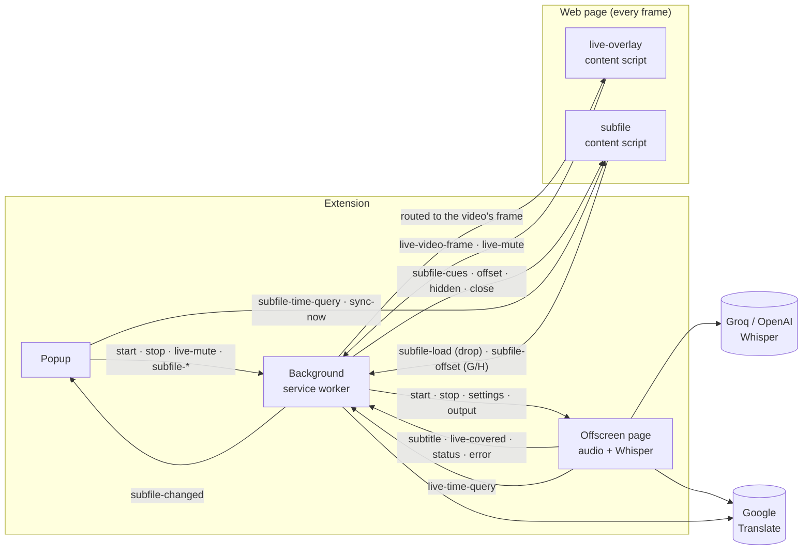

<div align="center">


# Live Subtitles Anywhere

**Subtitles for any video on any website — generated live by AI, or loaded from your own subtitle file.**

YouTube, Facebook, course platforms, news sites, embedded players… if it plays in Chrome, it can have subtitles,
in the language you want.


</div>

---

## Contents

**For users**
[Features](#features) · [Install](#install) · [Quick start](#quick-start) · [Using the popup](#using-the-popup) ·
[Keyboard shortcuts](#keyboard-shortcuts) · [Troubleshooting](#troubleshooting--faq) · [Privacy & permissions](#privacy--permissions) ·
[Known limitations](#known-limitations)

**For developers**
[Tech stack](#tech-stack) · [Getting started](#getting-started) · [Project structure](#project-structure) ·
[Architecture](#architecture) · [How live mode works](#how-live-mode-works) · [How subtitle-file mode works](#how-subtitle-file-mode-works) ·
[Debugging](#debugging) · [Conventions](#conventions) · [Roadmap](#roadmap) · [Contributing](#contributing)

---

# For users

## Features

### 🎧 Live AI subtitles
- Listens to the video's sound and writes subtitles as it plays, using **Whisper** (Groq or OpenAI).
- **Translates** into 35 languages (Arabic, English, French, Spanish, Turkish, Urdu, Chinese, …), or keeps the original language.
- **One subtitle at a time** — each new line replaces the previous one, so you always know what's new.
- **Remembers what it heard** while the page is open: rewind, and the subtitles reappear instantly, exactly when the words
  are spoken — without sending that audio again.
- **Works while muted**: mute the player, lower its volume, or use the extension's own mute — the subtitles keep going.
- Works on videos inside **embedded players** (iframes), and inside most **fullscreen** players.

### 📄 Your own subtitle file
- Load **.srt, .vtt, .ass or .ssa** — pick it in the popup or **drag it onto the video**.
- Stays in sync when you pause, jump, rewind or change speed.
- **Fix timing** with delay buttons, the **G / H** keys, or **Quick sync** ("this line is being said now").
  The delay is remembered for that file.
- **Automatic text-encoding detection** — old Arabic, Cyrillic, Greek, Hebrew, Turkish… files show correctly
  (or pick the encoding yourself).
- Can **translate the file** on the fly as the video plays.
- Comes back automatically if you reload the page. No API key needed.

### 🎨 Styling
- **Separate styles** for AI subtitles and file subtitles.
- Size, position, width, text/background colors, background opacity, font, outline/shadow, bold — plus presets.
- Every change shows **on the video immediately**, while it plays.

## Install

> The extension isn't on the Chrome Web Store yet, so it's installed from the source code. It takes about two minutes.
> Works in **Chrome, Edge and Brave** (desktop).

1. Install [Node.js](https://nodejs.org) **22 or newer**.
2. Download this project (**Code → Download ZIP** and unzip it, or `git clone` it).
3. In the project folder, run:
   ```bash
   npm install
   npm run build
   ```
4. Open `chrome://extensions` and turn on **Developer mode** (top right).
5. Click **Load unpacked** and choose the **`.output/chrome-mv3`** folder inside the project *(not the project folder itself)*.
6. Click the puzzle-piece icon in the toolbar and **pin** Live Subtitles, so its 🎬 icon is always visible.

**Updating:** download the new version, run `npm run build` again, then click the **↻ reload** icon on the extension's card in `chrome://extensions`.

## Quick start

### Subtitle file (no account needed)
1. Open the page with the video.
2. Click the 🎬 icon → **📄 Subtitle file** tab → **Choose subtitle file…**
   *(or simply drag the .srt / .vtt / .ass file onto the video)*.
3. Play the video. That's it — jump anywhere and the right line shows.

### Live AI subtitles
1. **Get an API key** (one time):
   - **Groq** (free tier, fast): sign up at [console.groq.com/keys](https://console.groq.com/keys) and create a key.
   - or **OpenAI**: [platform.openai.com/api-keys](https://platform.openai.com/api-keys) (paid; allows faster subtitles during non-stop speech — see [the delay FAQ](#why-are-live-subtitles-a-few-seconds-late)).
2. Open the page with the video and click the 🎬 icon → **🎧 Live (AI)** tab.
3. Choose the **Speech engine**, paste your **API key**, and pick **Show subtitles in** (e.g. العربية).
4. Press **Start subtitles on this tab** and play the video. Subtitles appear after a couple of seconds.
5. Press **Stop subtitles** when you're done.

## Using the popup

Click the 🎬 toolbar icon. The popup controls the tab you're on; the video keeps playing while it's open.
*(Like every Chrome popup, it closes when you click the page — just click the icon again. Nothing is lost.)*

### 🎧 Live (AI) tab
| Control | What it does |
|---|---|
| **Speech engine** | Groq Whisper (free tier) or OpenAI Whisper. |
| **API key** | Your key for that engine. Stored only in your browser. |
| **Video language** | *Detect automatically*, or tell it the spoken language for better accuracy. |
| **Start / Stop subtitles on this tab** | Starts or stops listening. If another tab is live, the button offers to **move** subtitles to this tab. |
| **🔇 Mute the video's sound** | Silences the video but keeps the subtitles going (shown while live mode runs). |

### 📄 Subtitle file tab
| Control | What it does |
|---|---|
| **Choose subtitle file…** | Loads a .srt / .vtt / .ass / .ssa file onto the current tab. You can also drop the file onto the video. |
| **✕ Remove** | Takes the subtitles off this tab. |
| **Delay** (−1s · −0.1 · +0.1 · +1s · ↺) | Shifts the subtitles earlier/later. Remembered per file name. |
| **Quick sync** (◀ line ▶ + 🎯) | Pick a line, press 🎯 the moment you hear it — the delay is set for you. The line follows the video until you use ◀ ▶. |
| **Hide subtitles** | Hides them without unloading the file. |
| **Text encoding** | *Automatic* by default; pick one if letters look broken. |

### Shared
| Control | What it does |
|---|---|
| **Show subtitles in** | Translate into this language (both modes), or *Same as original*. |
| **Also show original text** | Shows the original line in smaller text above the translation. |
| **🎨 Subtitle style** | Choose **AI subtitles** or **File subtitles**, then adjust size, height from bottom, max line width, text / background / original-line colors, background opacity (0% = no box), font, text edge (none / shadow / outline / both), bold. Presets: *Classic, Yellow, No box, Large, Reset*. |

## Keyboard shortcuts

On the video page, while a subtitle file is loaded:

| Key | Action |
|---|---|
| **G** | Subtitles 0.1 s earlier |
| **H** | Subtitles 0.1 s later |
| **Shift + G / H** | 1 second earlier / later |

(Ignored while you're typing in a text box.)

## Troubleshooting / FAQ

#### Why are live subtitles a few seconds late?
The extension can only hear audio as the video plays it, and Whisper needs a moment to transcribe it.
It sends short pieces of audio cut at natural pauses, so in normal dialogue subtitles arrive about **2–3 s** after the words.
During **non-stop speech on Groq's free tier** it's closer to **5 s**: Groq allows about 12 requests a minute
(it bills each request as at least 10 s of audio), and the extension paces itself to stay under that limit instead of
getting "rate limit" errors. An **OpenAI key** or a paid Groq plan allows more requests, so pieces stay short.
Once heard, a part of the video is remembered — **rewinding shows its subtitles instantly and in sync**.

#### Do subtitles keep working if I mute the video?
Yes. Turning the player's volume down is compensated automatically. If you mute the player, the extension quietly takes
the mute over (so it can still hear the audio) and shows a **🔇 Sound off · subtitles on** chip on the video — click it,
or un-mute in the player, to get the sound back. You can also use **🔇 Mute the video's sound** in the popup.
Muting Windows / your speakers never affects the subtitles.

#### "Cannot capture a tab with an active stream"
Something else is already capturing that tab's audio — another extension (screen recorders, other translators) or
sharing the tab in Meet, Zoom or Discord. Stop it and press **Start** again.

#### "Chrome didn't allow capturing this tab"
Chrome only lets an extension capture a tab after you open it on that tab. Close the popup, click the 🎬 icon again
while on the video's tab, and press **Start**.

#### "API key rejected" / "Rate limit reached"
Check the key in the popup (and that the **Speech engine** matches it). Rate limits are handled automatically: the
extension slows down for a moment and the message appears once.

#### The subtitle file's letters look broken (e.g. `ÇáÓáÇã`)
Open the **Text encoding** menu and pick the file's language — e.g. *Arabic (Windows-1256)*.

#### No subtitles appear in fullscreen
Most players (YouTube, etc.) are supported. On sites that make the bare `<video>` element fullscreen, file subtitles use
Chrome's built-in subtitle display instead; live subtitles only show in normal/theater mode there.

#### The popup closed when I clicked "Choose subtitle file…"
On some systems Chrome closes popups when a file dialog opens. Drag the file onto the video instead.

#### It doesn't work on some pages
Chrome doesn't allow extensions on `chrome://` pages, the Chrome Web Store, or other extensions' pages.
DRM-protected streaming services may also block audio capture.

## Privacy & permissions

- **Your API key** is saved only in your browser (`chrome.storage.local`). It's sent only to the speech engine you chose.
- **Audio** is sent only in live mode, only from the tab you started it on, only to your chosen engine
  (`api.groq.com` or `api.openai.com`) — and silent parts are never sent.
- **Text to translate** is sent to Google Translate's public endpoint (`translate.googleapis.com`).
- **Subtitle files** never leave your computer (unless you ask to translate them — then the lines go to Google Translate).
- Live subtitles are kept **in memory** only while the page is open. Nothing is saved to disk, and there are no analytics.

| Permission | Why it's needed |
|---|---|
| `tabCapture` | Hear the tab's audio for live subtitles. |
| `offscreen` | Process that audio in a hidden extension page (service workers can't use audio APIs). |
| `activeTab`, `scripting` | Draw subtitles on the page you're watching. |
| `storage` | Remember your settings, styles and per-file delays. |
| `<all_urls>` (host access) | Video players are often embedded from other sites (iframes); drawing subtitles over them requires access to those frames. |

## Known limitations
- Live mode can't show subtitles *before* the words are spoken on a first watch — it can only hear audio as it plays.
- Only one tab can have live subtitles at a time.
- Translation uses Google Translate's free public endpoint, which is unofficial and may occasionally rate-limit.
- Desktop Chromium browsers only (Chrome, Edge, Brave). Firefox and Safari aren't supported.

---

# For developers

## Tech stack
- **[WXT](https://wxt.dev)** (Vite-based) — builds the Manifest V3 extension, generates the manifest, hot-reloads in dev.
- **TypeScript**, strict mode with `noUncheckedIndexedAccess`.
- **ESLint** (`typescript-eslint` recommended rules).
- No UI framework and no runtime dependencies: plain DOM, Web Audio (`AudioWorklet`), inline-styled overlays.

## Getting started
```bash
npm install          # also runs `wxt prepare` (generates .wxt/ types)
npm run dev          # opens a Chrome window with the extension loaded; reloads on save
npm run build        # production build → .output/chrome-mv3
npm run zip          # build + zip for the Chrome Web Store
npm run typecheck    # tsc --noEmit
npm run lint         # eslint
```
Requires Node.js **22+**. To use your normal Chrome profile instead of `npm run dev`, run `npm run build` and load
`.output/chrome-mv3` unpacked.

## Project structure
```
entrypoints/                  one folder/file per extension context (WXT convention)
├─ background.ts              service worker: routing, live start/stop, per-tab subtitle-file state
├─ offscreen/                 hidden page: tab audio capture → chunks → Whisper → translation
├─ popup/                     the toolbar popup (Live / File / Style controls)
├─ live-overlay.content.ts    injected into every frame: draws live subtitles, keeps the video timeline
└─ subfile.content.ts         injected into every frame: draws file subtitles, drag & drop, G/H keys
lib/                          shared, framework-free modules
├─ messages.ts                typed union of every runtime message + typed send helpers
├─ settings.ts                settings/defaults, per-mode styles, storage migration
├─ style.ts                   subtitle look (inline styles, ::cue CSS)
├─ overlay.ts                 subtitle box creation, placement, fullscreen mounting
├─ video.ts                   pick the video the user is watching
├─ subparse.ts                encoding detection, SRT/VTT/ASS parsing, binary-search cue lookup
├─ timeline.ts                live cues by video time + "already transcribed" ranges
├─ chunker.ts                 cut the audio stream into chunks at pauses
├─ budget.ts                  token-bucket rate limiter per speech provider
├─ wav.ts                     downsample to 16 kHz mono + WAV encoding
├─ translate.ts               Google Translate (single + batched)
├─ bytes.ts                   base64 helpers (file bytes travel through JSON messages)
└─ languages.ts               language list
public/
├─ pcm-worklet.js             AudioWorklet: streams raw PCM blocks from the audio thread
└─ icons/
wxt.config.ts                 manifest fields (permissions, icons, action)
```

## Architecture

Five contexts, talking only through typed messages (`lib/messages.ts`):



- **Background** owns state that must outlive the popup: which tab is live (`storage.session`), which frame plays its
  video, and each tab's loaded subtitle file (bytes, encoding, delay) so it survives popup closes, service-worker restarts
  and page reloads.
- **Offscreen document** exists only during live mode (service workers can't use `getUserMedia` / Web Audio).
- **Content scripts** are registered at runtime (not in the manifest) and injected with `chrome.scripting` into **all frames**,
  because players are often cross-origin iframes. Only the frame whose `<video>` is the main one draws.

## How live mode works

```
tab audio ─▶ AudioWorklet ─▶ Chunker ─▶ WAV 16 kHz ─▶ Whisper ─▶ translate ─▶ subtitle {source, translated, timing}
               (PCM blocks)   (cuts at pauses,         (≤3 requests in flight,                │
                               within rate budget)      paced by RateBudget)                   ▼
                                                           page: Timeline (by video time) ─▶ one line on screen
```

1. **Capture** — the popup gets a stream id (`tabCapture.getMediaStreamId`); the offscreen page opens it and re-plays it
   through a `GainNode` (capturing a tab silences it otherwise — and that gain is how "mute, keep subtitles" works).
2. **Chunking** — `public/pcm-worklet.js` posts raw PCM; `Chunker` cuts at the first 250 ms pause once a chunk is ≥1.5 s,
   or at 4 s. Silent chunks are never sent. After a hard cut the next chunk repeats 0.3 s so split words survive.
3. **Rate budget** — `RateBudget` is a token bucket (Groq: 11/min, burst 3; OpenAI: 45/min). The chunker only cuts
   speech into a new request when a token is available (up to a 12 s cap), so the free tier doesn't hit 429s.
4. **Video time** — when a chunk starts and ends, the offscreen page asks the video's frame for `{t, paused, rate, volume,
   videoKey, covered}`. Chunks recorded across a seek/pause are dropped; ranges already `covered` are skipped
   (rewinds cost no API calls); low player volume is compensated with up to 20× gain.
5. **Timeline** — the page stores cues per video (`lib/timeline.ts`) and draws the **newest line only**: the line for
   the current video time, or one that just arrived late. Language changes re-translate remembered lines lazily.
6. **Errors** — 401 stops capture; 429/5xx/network back off 1 s → 2 s → … 15 s and are reported once per streak.

## How subtitle-file mode works
- The popup (or a drop on the page) sends the file's bytes (base64) to the background, which decodes it
  (`subparse.decode`, scoring legacy code pages by letter frequency), parses it, stores it per tab in `storage.session`,
  injects the script into all frames and broadcasts the cues.
- Each frame renders on `requestAnimationFrame`, looking up active cues by binary search, and only touches the DOM when
  the visible text changes. When the bare `<video>` is fullscreen it switches to a native `TextTrack` + `::cue` styling.
- Delay changes (buttons, G/H, Quick sync) go through the background, which saves them per file name (last 100 files).

## Debugging
| Context | Where to look |
|---|---|
| Background | `chrome://extensions` → *Live Subtitles* → **service worker** |
| Offscreen (audio, Whisper, network) | same card → *Inspect views* → **offscreen.html** (only while live mode runs) |
| Popup | right-click the popup → **Inspect** |
| Content scripts | the page's DevTools console (pick the frame in the context dropdown for iframes) |

Tips: watch the offscreen page's **Network** tab to see transcription requests (rewinding over a known part should send none).
`chrome.storage.session` holds `activeTabId`, `liveFrame:<tab>`, `liveMuted` and `subfile:<tab>`.

## Conventions
- **Messages** are typed in `lib/messages.ts`; always send through `sendToBackground` / `sendToOffscreen` / `sendToTab`.
- **Settings & defaults** live only in `lib/settings.ts` (styles per mode: `liveStyle`, `fileStyle`).
- Keep `lib/` modules free of extension APIs where possible (`subparse`, `timeline`, `chunker`, `budget`, `wav`), so they're unit-testable.
- Use `textContent`, never `innerHTML`, for anything that came from a file, the API or translation.
- Commits follow Conventional Commits (`feat:`, `fix:`, `refactor:` …).

## Roadmap
- [ ] Unit tests (Vitest) for the parser, encodings, timeline, chunker, budget and WAV encoder — and CI on every push
- [ ] Translation through the user's Groq key (LLM) with context from previous lines; Google Translate as fallback
- [ ] Arabic and more languages in the hallucination filter
- [ ] Export the live transcript as `.srt`
- [ ] Keyboard shortcut to start/stop live mode
- [ ] Popup in Arabic (`_locales`)
- [ ] Chrome Web Store release

## Contributing
Issues and pull requests are welcome. Before opening a PR, run `npm run typecheck && npm run lint && npm run build`
and describe how you tested it in the browser (site, mode, what you checked).

## License
[MIT](LICENSE) © 2026 Lamiaa Gebriel
